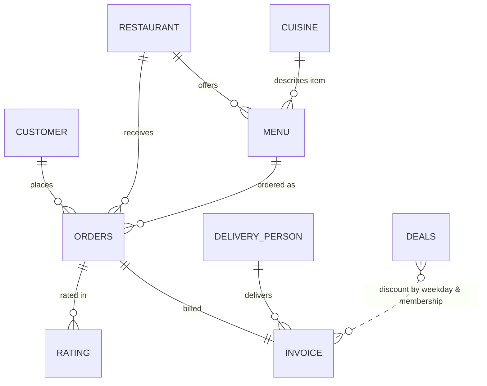
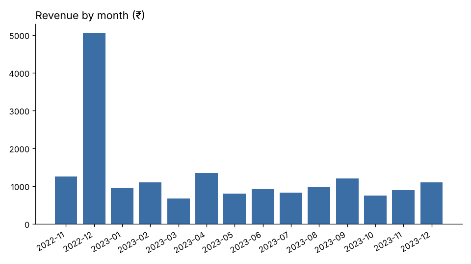

# Restaurant Data Analysis & Management


  

A relational database and analytics project that helps restaurant owners make **data-driven decisions**:
a normalized MySQL schema for a food-delivery business (restaurants, customers, menus, orders, invoices,
delivery staff, deals and ratings), SQL analysis queries, query optimization, role-based access control,
and an automated **Python analytics report** with charts.

> 📊 **[See the generated analytics report →](reports/REPORT.md)**

## Data model




9 tables: `Restaurant`, `Customer`, `Cuisine`, `Menu`, `Orders`, `Invoice`, `Delivery_Person`, `Deals`, `Rating`.

## What's inside

| Path | Contents |
|---|---|
| `SQL Files/Table creation and inserting value.sql` | Schema (primary/foreign keys) + sample data |
| `SQL Files/SQL Queries.sql` | Original analysis queries — window functions (`RANK`, `DENSE_RANK`), multi-table `JOIN`s, aggregations, `UNION` |
| `SQL Files/indexes_and_optimization.sql` | Indexes for the hot joins/filters + `EXPLAIN` plan |
| `SQL Files/user_access_control.sql` | Least-privilege users: read-only analyst and application account |
| `analysis/kpi_queries.sql` | Portable KPI queries using CTEs (MySQL 8 `ONLY_FULL_GROUP_BY`-safe) |
| `analysis/analyze.py` | Runs the KPIs, exports CSVs, draws charts, writes `reports/REPORT.md` |
| `analysis/test_queries.py` | pytest smoke tests: every original + KPI query executes |
| `docker-compose.yml` | MySQL 8 that auto-loads schema, data and indexes |
| `Report/Project Report.pdf` | Full project report |

## Business questions answered

- Top-rated restaurants, delivery partners and menu items (overall and per restaurant / cuisine)
- Most-ordered item per cuisine and most-ordered cuisine
- Revenue by month, by restaurant (top & bottom), by payment type, and by discount level
- Delivery-partner performance: deliveries, revenue delivered, average rating
- Premium vs. standard customer behaviour
- **Data-quality checks** — e.g. invoices referencing orders that have no order lines

### Sample findings (from the included data)

- Total revenue **₹17,820** across 18 invoices; average order value **₹990**
- **Cash** is the most common payment method (39% of invoices)
- **Vegetable Biryani** is the best-selling item; **Spicy Venue** is the top-rated restaurant
- **12 of 18 invoices** have no matching order lines → recommended adding a foreign key on `Invoice.order_id`



## Run it

**1. Database (Docker — no MySQL install needed)**
```bash
docker compose up -d                                   # MySQL 8 on localhost:3306, user root / root
mysql -h 127.0.0.1 -uroot -proot restaurant < "SQL Files/SQL Queries.sql"
```
Or use **MySQL Workbench**: run `Table creation and inserting value.sql`, then `SQL Queries.sql`.

**2. Analytics report**
```bash
pip install -r analysis/requirements.txt
python analysis/analyze.py          # writes reports/REPORT.md, CSVs and charts
cd analysis && pytest -q            # every query runs cleanly
```

CI (GitHub Actions) spins up MySQL 8, loads the schema, applies indexes and user grants, runs every query
as a test, and uploads the generated report as a build artifact.

## Techniques

- Relational modelling with primary / composite / foreign keys
- Window functions (`RANK`, `DENSE_RANK`, `SUM() OVER()`), CTEs, subqueries, `UNION`
- Indexing and `EXPLAIN`-driven query optimization
- Role-based access control with `CREATE USER` / `GRANT`
- Python data pipeline: SQLAlchemy → pandas → matplotlib → Markdown report

## Known limitations & next steps

- Sample data stores passwords in plain text — a production system should store salted hashes (bcrypt/argon2).
- Several "last N days" queries use `NOW()` and return no rows for the 2022–2023 sample data; anchoring to `(SELECT MAX(order_date) FROM Invoice)` (as in `indexes_and_optimization.sql`) makes them work on historical data.
- Next: enforce `Invoice.order_id` → `Orders` foreign key, add a BI dashboard (Power BI / Streamlit), and generate larger synthetic data for performance testing.
