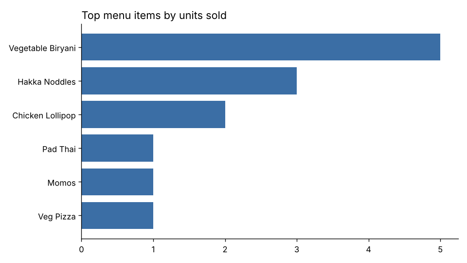
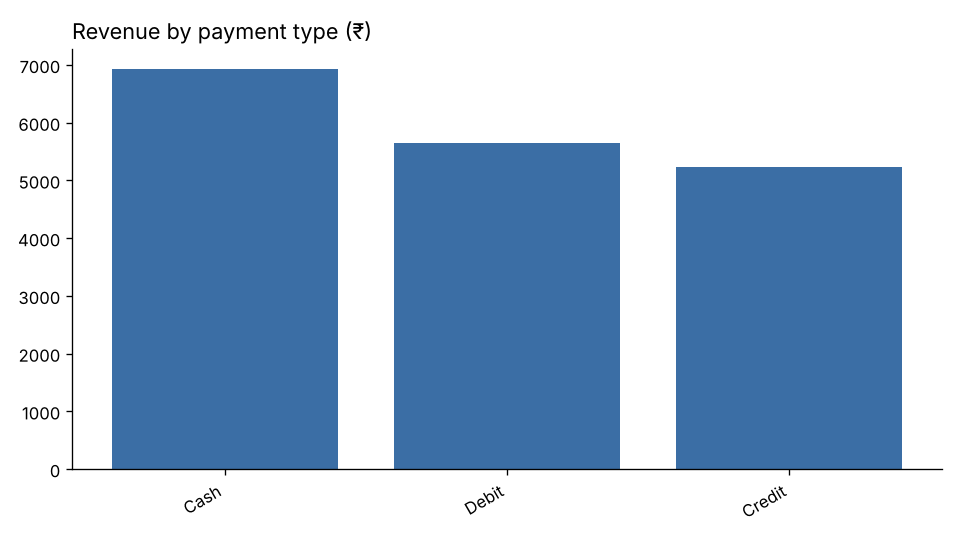

# Restaurant Analytics Report

_Generated by `analysis/analyze.py` from the MySQL database._

## Key findings

- **Total revenue:** ₹17,820.00 across 18 invoices (average order value ₹990.00).
- **Best month:** 2022-12 with ₹5,040.00.
- **Most popular item:** Vegetable Biryani (Indian), 5 units.
- **Top-rated restaurant:** Spicy Venue (avg rating 4.4).
- **Data quality:** 12 of 18 invoices reference orders with no order lines → add a FOREIGN KEY from Invoice.order_id and validate at insert time.

## Payment mix

| payment_type   |   invoices |   revenue |   pct_of_invoices |
|:---------------|-----------:|----------:|------------------:|
| Cash           |          7 |      6930 |              38.9 |
| Debit          |          5 |      5650 |              27.8 |
| Credit         |          6 |      5240 |              33.3 |

## Delivery person performance

| dp_id   | delivery_person   |   deliveries |   revenue_delivered | avg_rating   |
|:--------|:------------------|-------------:|--------------------:|:-------------|
| D1      | Moith Kumar       |            5 |                4830 | 4.54         |
| D4      | Joshi Doshi       |            5 |                4970 | 4.23         |
| D3      | Piyush Patel      |            4 |                3550 | 4.4          |
| D2      | Shinde Shetty     |            4 |                4470 | 4.1          |
| D7      | Kunal Joshi       |            0 |                   0 | –            |
| D6      | Aisha Patil       |            0 |                   0 | –            |
| D10     | Tanya Kapoor      |            0 |                   0 | –            |
| D5      | Anubhav Shankar   |            0 |                   0 | –            |
| D9      | Rajat Gandhi      |            0 |                   0 | –            |
| D8      | Mira Shah         |            0 |                   0 | –            |

## Restaurant ratings

| res_name    |   rated_orders |   avg_restaurant_rating |   avg_item_rating |   rating_rank |
|:------------|---------------:|------------------------:|------------------:|--------------:|
| Spicy Venue |              2 |                    4.4  |              4.57 |             1 |
| Makau       |              3 |                    4.25 |              4.32 |             2 |

## Discount impact

|   discount_percent |   invoices |   avg_invoice_amount |   revenue |
|-------------------:|-----------:|---------------------:|----------:|
|                 10 |          4 |               905    |      3620 |
|                 15 |          4 |               790    |      3160 |
|                 20 |          8 |              1073.75 |      8590 |
|                 25 |          2 |              1225    |      2450 |

## Premium vs standard customers

| premium_member   |   customers |   orders |   gross_sales |
|:-----------------|------------:|---------:|--------------:|
| no               |           7 |        3 |          2770 |
| yes              |           3 |        3 |          2180 |
